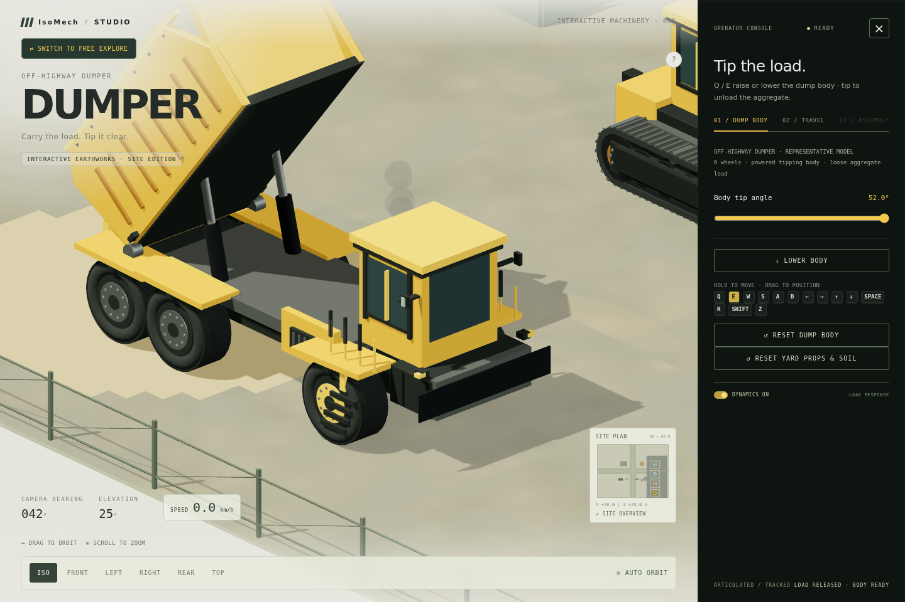

# ISO-MECH — Construction Machinery Studio

**A browser-based 3D studio where you operate an EX–240 excavator, a PR–180 rotary piling rig, a crawler dozer and an off-highway dumper on a procedural 90 × 68 m construction yard, explore it on foot, and take the excavator apart in an exploded view.**

[**Open the GitHub Pages demo →**](https://yugaldoddamani.github.io/ISO-MECH/)

> Publishing is not active yet: enable GitHub Pages for the `main` branch at `/` in the repository settings to make this URL live.

<p align="center">
  
  
  
  
</p>

## What you can explore

- **Four machines, one fleet.** Start on the PR–180 and cycle through the EX–240, the crawler dozer, the dumper and free explore with the switch button. Parked machines wait in their marked bays on the east-side apron and keep their position, heading and travel distance.
- **Operate each machine.** Boom, stick, bucket and slew on the excavator; mast rake, rotary-head feed, Kelly extension, slew and a spinning auger on the piling rig; blade lift and angle on the dozer; a powered tipping body on the dumper.
- **Drive.** Hold-to-drive tracks with differential steering (or Ackermann steering on the dumper), braking, speed limits, terrain-following pitch and roll, and track or tyre impressions left in the soil.
- **Work the yard.** The excavator digs and dumps with its bucket, the auger drills bore marks, the dumper releases its load, and every machine compacts and follows the ground it drives over (soft soil reduces traction). It all runs on a deterministic soil model that conserves material volume. Cones, fuel drums and loose pipes are physics props, and exhaust, travel and drilling make smoke and dust. **Reset Yard** restores it all.
- **Free explore.** Park the machines and fly the camera around the site with W/A/S/D, Q/E and Shift.
- **Inspect 13 systems.** Separate the excavator into its cab, power systems, arm, hydraulics, chassis and crawlers; select a part to read its role.
- **Desktop or phone.** Orbit, zoom and camera presets, keyboard control with live keycap feedback, and a dedicated touch gamepad on phones.

The complete key map, mobile layout and simulation scope are in [the operator guide](docs/operator-ui.md).

## Run locally

The app is a static site with no build step. three.js and cannon-es are loaded from the jsDelivr CDN, so you need an internet connection.

```bash
npm start            # or: python3 -m http.server 8000
```

Then open <http://127.0.0.1:8000/> in a WebGL-capable browser. Opening `index.html` directly from disk also works.

## Project layout

```text
index.html                 Page markup; loads the stylesheets, the CDN libraries and the application scripts in order
css/                       11 stylesheets, split by concern (base, console, assembly, site map, mobile, vehicle studio, …)
js/
  core/                    runtime (renderer, scene, start-up guard), shared state, camera, lighting, materials, geometry helpers
  vehicles/
    fleet.js               drive root, parked carriers, parking-bay records and the four machine instances
    excavator/             EX–240: undercarriage, upper body, arm, internals, assembly parts, joints and hydraulics
    pile-rig/              PR–180: procedural model, console controls, auger drilling
    bulldozer/             crawler dozer: procedural model, blade controls
    dumper/                off-highway dumper: procedural model, tipping-body controls
  environment/
    soil-simulation.js     deterministic, volume-conserving earthworks model
    construction-site/     ground and lanes, interactive yard, effects, bore marks, stockpiles, soil terrain, props, track marks
  physics/                 cannon-es yard physics adapter and the fixed-step accumulator
  systems/                 travel, exploded assembly, site navigation and collision, free explore
  input/                   keyboard and mobile gamepad
  ui/                      status toast, console sheet and help, console extras, studio controls
  app/                     vehicle switching, the main loop, the window.excavator API
scripts/                   serve.mjs (local server) and check.mjs (structure, load-order and integrity checks)
tests/                     Node unit tests and Playwright browser checks
docs/                      architecture, operator guide, embedding notes, screenshots
```

## How the code is organised

Every file in `js/` is a classic script. They share one global scope and run in the order listed in `index.html`, exactly as the sections of the original single-file closure did, so there are no imports or bundler. The vehicle models, the soil simulation, the physics adapter and the fixed stepper are standalone factories (`window.createPileRig`, `window.createSoilSimulation`, …). The rest are application modules, each starting with `'use strict'`.

Two rules keep this safe:

1. **While a module loads, it may only use names declared by itself or by modules above it.** Event handlers and functions that run later can use anything.
2. **Order matters for side effects.** Modules that create scene objects, DOM elements or consume the seeded random generator run in their original order.

`npm run check` verifies both automatically. See [docs/architecture.md](docs/architecture.md) for the module map, the start-up sequence, and how to add a vehicle or an environment.

### Libraries (CDN)

| Library | Version | Loaded from | How |
| --- | --- | --- | --- |
| three.js | r128 (`0.128.0`) | `cdn.jsdelivr.net/npm/three@0.128.0/build/three.min.js` | deferred `<script>` with SRI |
| OrbitControls | r128 | `…/three@0.128.0/examples/js/controls/OrbitControls.js` | deferred `<script>` with SRI |
| cannon-es | `0.20.0` | `cdn.jsdelivr.net/npm/cannon-es@0.20.0/dist/cannon-es.js` | ES module exposed as `window.CANNON`; SRI via `modulepreload` |

These are byte-for-byte the builds that were previously inlined in the page. If a library cannot be loaded, the loading screen says so instead of failing silently.

## Development

```bash
npm install          # dev tools only: Playwright, Prettier, the static checker, pinned three/cannon-es copies for tests
npm run check        # index.html manifest, load order between modules, CDN integrity hashes
npm test             # Node unit tests + Playwright browser checks (starts its own server)
npm run format       # Prettier
```

The browser checks answer the jsDelivr URLs from the pinned copies in `node_modules`, so they run offline while still enforcing the integrity hashes. Set `ISO_MECH_USE_CDN=1` to use the real CDN. Playwright needs a Chromium build: run `npx playwright install chromium`, or point `CHROMIUM_PATH` at an installed browser. See [tests/README.md](tests/README.md).

## Technical notes

- **Camera rig:** an orthographic camera with damped `OrbitControls`, kept above the ground. During travel, the camera and target receive the same eased translation, so you can keep orbiting while following the machine. The frustum blends between close-up, assembly and the full-yard overview.
- **Deterministic simulation:** machine motion, hydraulics, soil and props advance in fixed 60 Hz steps, independent of the display frame rate. The `window.excavator` API can advance the simulation step by step for automated checks.
- **Articulated motion:** the excavator is a hierarchy of named three.js groups. Joints are driven by a pump-limited, damped actuator model with cylinder kinematics, and guarded against the ground and the body envelope. It is a presentation model, not an engineering-grade hydraulic simulator.
- **Earthworks and physics:** the soil is a 0.5 m heightfield that conserves volume through digging, dumping, drilling and slope relaxation. cannon-es handles the loose props and machine envelopes. These are illustrative interactions, not geotechnical, rigid-body-accurate or drilling physics.
- **Exploded view:** thirteen systems move along machine-space offsets converted into each part's parent frame. Numbered anchors are projected into a separate label-and-guide overlay, and reassembly restores the saved pose and camera.

All models, textures and the yard are procedural; the machines are representative models rather than OEM or service CAD.

## Documentation

- [Architecture](docs/architecture.md): module map, load order, CDN and integrity, extending the studio
- [Operator guide](docs/operator-ui.md): key map, mobile layout, fleet, yard behaviour and simulation scope
- [Embedding](docs/embedding.md): iframe example and hosting notes
