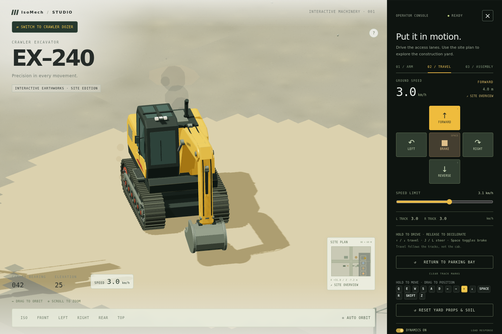
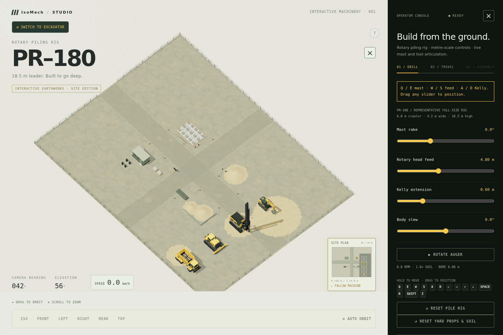
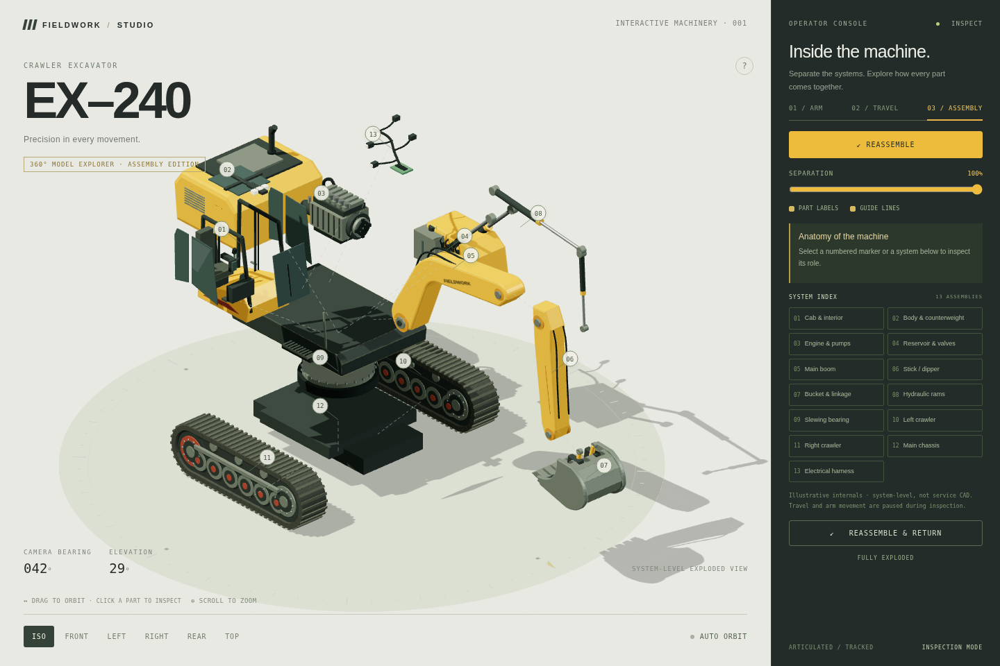

# ISO-MECH — Pile Drill & Excavator Studio

**A browser-based 3D machinery studio where you can operate a PR–180 piling rig or EX–240 excavator, drive a procedural construction site, and inspect the excavator in an exploded view.**

[**Open the GitHub Pages demo →**](https://yugaldoddamani.github.io/ISO-MECH/)

> Publishing is not active yet: enable GitHub Pages for the `main` branch at `/` in the repository settings to make this URL live.

<p align="center">
  
  
  
</p>

## What you can explore

- **Switch machines:** start with the PR–180 piling rig and switch to the EX–240 excavator. Both machines stay visible in marked bays on the east-side fleet apron; each keeps its own location, heading, and travel distance when parked. Adjust mast rake, rotary head feed, Kelly extension, and body slew; toggle auger rotation. The tool is ground-guarded; borehole drilling is not simulated. Assembly inspection is excavator-only.

- **Operate the arm:** control the boom, stick, bucket, and upper-body slew with touch controls or the keyboard; play or pause a short motion demo.
- **Drive the undercarriage:** accelerate, brake, and steer the selected machine's tracks independently. Track shoes, rollers, and ground impressions respond to signed travel distance.
- **Explore the job site:** start with an overview of the expanded 90 × 68 m procedural yard, including the fleet apron, live site plan, obstacles, and chassis-clearance checks. Switch to a follow camera when driving.
- **Interact with the yard:** push over cones, roll loose pipes, and deform stockpiles with loose-soil particles; reset the yard independently of the machine. These are lightweight effects rather than full digging physics.
- **Inspect 13 systems:** separate the cab, power systems, arm, hydraulics, chassis, and crawlers; select a label to highlight a component and read its role.
- **Use it on desktop or mobile:** orbit and zoom the model, choose camera presets, and use the responsive touch controls.

See [the operator controls and interaction scope](docs/operator-ui.md) for the complete key map, mobile layout, and physics limitations.

## Technical challenges

- **Camera rig:** The scene uses an orthographic camera with damped `OrbitControls`, constrained to keep the view above the ground. During travel, the camera and target receive the same eased translation, so the operator can keep orbiting without losing the selected machine. The initial site overview frames the entire 90 × 68 m yard and both parked rigs; switching to a machine-specific follow view is one click away.
- **Articulated motion:** The excavator is a hierarchy of named Three.js groups; each arm joint rotates in its parent frame. Damped, sub-stepped actuator targets add hydraulic-style lag and settling. A pose guard checks bucket clearance against the ground and body envelope before accepting a joint pose. This is a presentation model, not an engineering-grade hydraulic or rigid-body simulator.
- **Exploded view:** Thirteen systems retain their assembled transforms and are moved along machine-space offsets converted into each part's parent frame. The transition keeps the arm pose coherent, reveals illustrative cab and powertrain internals, and projects numbered anchors into a separate label-and-guide overlay. Reassembly restores the saved pose and camera.

## Run locally

The app is static and self-contained—Three.js, its controls, and procedural textures are included locally. No API keys, model downloads, package install, or build step are needed to try it.

```bash
python3 -m http.server 8000
```

Open [http://localhost:8000](http://localhost:8000) in a WebGL-capable browser. Use **drag / scroll** to orbit and zoom; **Q / E**, **W / S**, and **A / D** for the arm; **← / →** to slew; **↑ / ↓** and **J / L** to drive and steer; **Space** to toggle the brake; and **03 / Assembly** to inspect the exploded view.

## Build and project layout

Run `python3 scripts/assemble.py` after editing source files. It combines `page-shell.html`, `pile-drill.js`, `excavator-app.js`, `three.min.js`, and `OrbitControls.js` into the standalone `index.html` and `excavator.html` deliverables.

- `index.html` — GitHub Pages entry point.
- `excavator.html` — standalone build, also suitable for embedding.
- `page-shell.html`, `excavator-app.js` — editable UI and application source.
- `pile-drill.js` — procedural piling rig model and articulation.
- `scripts/migrations/` — historical development helpers; not part of the normal build.
- `tests/` — Playwright browser checks. See [`tests/README.md`](tests/README.md) for setup and run instructions.
- [`docs/embedding.md`](docs/embedding.md) — iframe example, controls, and simulation scope.

The model, soil, yard details, and textures are procedural. The assembly's internal engine, valve system, and wiring are illustrative rather than exact service CAD.
